# OpenCode Orchestrator Suite

Production-grade multi-agent orchestration ecosystem and plugin suite for **OpenCode** featuring a
mandatory recon -> design -> implement -> verify sequence, an opt-in TUI plan panel, strict MCP tool
isolation, and a 2-level hierarchical memory model.

---

## 📐 Architecture Topology

```mermaid
graph TD
    User([User Request]) --> Orch[Orchestrator Controller]
    
    subgraph Primaries
        Orch -.->|Design & trade-offs| Arch[Architect]
    end

    subgraph Memory Spine
        Orch <-->|Before recon / after verify| Lib[Librarian]
    end

    subgraph Recon
        Orch -->|Verified facts path:line| Explorer[Explorer]
        Orch -->|Broad research| General[General]
    end

    subgraph Implement
        Orch -->|Closed-spec code| Coder[Coder]
        Orch -->|Shell & commands| Worker[Worker]
        Orch -->|Containers / systemd / deploy| Infra[Infra]
    end

    subgraph Verify
        Orch -->|Test execution| Tester[Tester]
        Orch -->|Read-only gate| Reviewer[Reviewer]
        Orch -->|Root cause| Debugger[Debugger]
        Orch -->|Docs| Documenter[Documenter]
    end

    subgraph Specialized
        Orch -->|Web & SPA| Browser[Browser]
        Orch -->|DNS / WAF / TLS| CF[Cloudflare]
        Orch -->|Zabbix & metrics| ZBX[Zabbix]
        Orch -->|Remote tunnel & SSHFS| Remote[OpenCode Remote CLI / Plugin]
    end

    subgraph Security
        Orch -->|static audit after reviewer| SA[sec-audit]
        Orch -->|validate a finding| SP[sec-pentest]
        Orch -->|remediate| SF[sec-fix]
    end

    Orch -.->|Plan artifacts opt-in| PlanPanel[Plan Panel Plugin]

    Lib <-->|Read/Write Memory| ProjectMem[(Project Memory)]
    Lib <-->|Read/Write Memory| GlobalMem[(Global Memory)]

    Worker -->|File Edits / Shell| Codebase[(Workspace Codebase)]
```



---

## 🚀 Key Highlights & Components

### 1. Sequence: Recon -> Design -> Implement -> Verify
Enforced on the primary agents (`@orchestrator`, `@architect`):
- **Recon:** `@explorer` returns verified facts with `path:line`; `@librarian` returns prior decisions.
- **Design:** `@architect` settles approach, trade-offs, and the execution path **before** any code-modifying agent runs.
- **Implement:** atomic closed specs (`target files` + `change` + `acceptance criteria`).
- **Verify:** `@tester` for behavior, `@reviewer` as the read-only quality gate.

Plans are used when the task benefits from one, following whatever plan convention is active at
runtime — no plan path, frontmatter, or status value is hardcoded in any agent prompt.

### 2. Architect Response Standard
`@architect` follows a fixed 9-section contract so every answer is directly actionable:
`RESUMO` -> `CONTEXTO` -> `OPCOES` (always 2-4, in a table when 3+) -> `ANALISE` (reversibility,
blast radius, cost) -> `DIAGRAMA` (Mermaid) -> `RECOMENDACAO` (explicit pick + what would flip it) ->
`RISCOS` (top 3 + mitigation) -> `EXECUCAO` (atomic checklist) -> `PERGUNTAS` (only when blocked).

### 3. Agent Frontmatter Policy
- **No model pins.** Agents inherit the session model, so a pinned model going unavailable never
  breaks a subagent. To pin one, add `model: provider/model` to the agent frontmatter.
- **Tool isolation is explicit.** Heavy MCP servers (`browser`, `cloudflare`, `omni-remoto`) are
  denied by default and granted only to the specialist that needs them; `explorer` and `reviewer`
  additionally have `write`/`edit` disabled, making their read-only nature structural, not just
  prompt-based.

### 4. Routing & Cost
Measured with `tools/orchestrator_analytics`: broad tasks concentrated ~85% of cost in a single
agent, because nothing decided who got the work. The orchestrator now applies:
- one tool call solves it -> do it yourself, never delegate trivia;
- surgical, fully specified change -> `@coder` (or `@worker` for shell only);
- broad multi-step implementation -> stays with the primary, which delegates only recon, tests and review;
- at most **3 subagents concurrently**, one specialist per objective.

### 4.1 Full Agent Roster
Every configured agent has an objective in the flow — nothing is orphaned.

| Agent | Objective | Kind |
| --- | --- | --- |
| `@orchestrator` | plan, coordinate, arbitrate, maintain state | primary |
| `@architect` | design, trade-offs, diagrams, response standard | primary |
| `@librarian` | memory: prior decisions, constraints, watchlists | subagent |
| `@explorer` | recon, verified facts with `path:line` | subagent |
| `@general` | broad research / mixed-tool work | subagent |
| `@coder` | surgical code from a closed spec | subagent |
| `@worker` | shell and command actuation | subagent |
| `@tester` | test generation and execution | subagent |
| `@reviewer` | read-only quality gate | subagent |
| `@debugger` | root-cause analysis | subagent |
| `@documenter` | documentation sync | subagent |
| `@infra` | Docker, systemd, deploy, reverse proxy | subagent |
| `@browser` | web, SPA, console/network inspection | subagent |
| `@cloudflare` | DNS, WAF, Workers, TLS, Cloudflare docs | subagent |
| `@zabbix` | Zabbix API, monitoring, metrics, triggers | subagent |
| `@sec-audit` | static security audit (OWASP/CWE) | subagent, read-only |
| `@sec-pentest` | safe exploitation validation | subagent, read-only |
| `@sec-fix` | security remediation | subagent, least-privilege |

**Memory is a step, not a phase.** `@librarian` runs *before* recon (decisions, constraints, watchlists
and the stored recon map), at the design gate (persist what `@architect` decided), and *after*
verification (persist new constraints and rejected approaches).

**Recon cache.** `@explorer` returns a `recon_map` (entry points, key modules with `path:line`,
conventions, build/test commands). It is persisted once in the project memory block; later tasks load
it and dispatch recon only for the delta. Re-running the same exploration was the most common waste in
this system — `no_output` was the single largest breach cause (15 of 27).

**Security is a gate, and it is delegated.** For auth, crypto, network, upload or input-handling
changes the flow dispatches `@sec-audit` (static) after `@reviewer`, `@sec-pentest` when a finding
needs proof, and `@sec-fix` for remediation. All three are read-only or least-privilege with `bash`
denied at the tool layer: scanners and test runs are the primary's job, executed from the
`SCANNER_REQUESTED` / `VERIFY_REQUESTED` lines they emit.

### 5. TUI Plan Panel Plugin (`plugins/plan-panel`) — opt-in
- **Disabled by default** and not installed by `./install.sh` unless `--with-plan-panel` is passed.
- Interactive SolidJS TUI panel embedded directly in OpenCode.
- Keybinding: `Ctrl+G` to toggle viewer, or slash command `/plans` (`/plan`, `/plano`).

### 6. OpenCode Remote Integration ([`berndof/opencode-remote`](https://github.com/berndof/opencode-remote))
- Maintained as a standalone package & repository: [`https://github.com/berndof/opencode-remote`](https://github.com/berndof/opencode-remote).
- CLI command `opencode-remote` (and aliases `ocd`, `oc-remote`), `/remote` TUI plugin, and agent skill.
- Install standalone via:
  ```bash
  curl -fsSL https://raw.githubusercontent.com/berndof/opencode-remote/main/install.sh | bash
  ```

### 7. Strict MCP Tool Isolation & Memory Hierarchy
- High-overhead tool schemas (e.g. Cloudflare, Browser Puppeteer) are scoped strictly to specialist subagents.
- Memory: Level 1 (Committed code on disk) > Level 2 (Project memory / `.opencode/memory/`) > Level 3 (Global memory).

---

## 📦 Prerequisites & System Dependencies

- **Node.js:** `>= 18.0.0`
- **OpenCode:** `>= 0.2.0`

---

## 🛠️ Installation & Setup

### Automated Installation (Recommended)

Run the colorized installer to deploy agents, memories, and optional plugins:

```bash
# Clone the repository
git clone https://github.com/berndof/opencode-orchestrator.git
cd opencode-orchestrator

# Symlink mode (recommended for live editing and dev updates)
./install.sh --symlink

# Or standard copy mode
./install.sh --copy

# Opt-in: also install the plan-panel TUI plugin (not installed by default)
./install.sh --symlink --with-plan-panel

# Custom destinations
./install.sh --target ~/.config/opencode --force
```

### Manual Configuration

1. **Agents:** Copy/symlink `agents/*.md` to `~/.config/opencode/agents/`
2. **Memory:** Copy/symlink `memory/*.md` to `~/.config/opencode/memory/`
3. **Plugins (opt-in):** Copy/symlink `plugins/plan-panel` to `~/.config/opencode/plugins/plan-panel`

---

## 📂 Repository Structure

```
opencode-orchestrator/
├── agents/                  # Specialized agent prompt definitions
│   ├── orchestrator.md      # Controller / Main Orchestrator agent
│   ├── architect.md         # Solution design & Mermaid diagrams
│   ├── coder.md             # Production code implementation specialist
│   ├── tester.md            # Test execution & verification agent
│   ├── reviewer.md          # Static analysis & code review specialist
│   ├── debugger.md          # Root cause analysis & bug fix agent
│   ├── documenter.md        # Technical documentation & markdown agent
│   ├── worker.md            # Shell execution & fallback actuator
│   ├── explorer.md          # Fast code discovery & search
│   ├── librarian.md         # Hierarchical memory & state manager
│   ├── infra.md             # Docker, Compose & Infrastructure specialist
│   ├── cloudflare.md        # Cloudflare DNS/WAF/Workers specialist
│   ├── zabbix.md            # Zabbix API, monitoring, metrics & triggers
│   ├── browser.md           # Web search & browser automation agent
│   ├── sec-audit.md         # Static security audit subagent (read-only)
│   ├── sec-pentest.md       # Safe exploitation validation subagent (read-only)
│   └── sec-fix.md           # Security remediation subagent (least-privilege)
├── plugins/                 # OpenCode V2 TUI Plugins (SolidJS)
│   └── plan-panel/          # Active plan artifact visualizer (Ctrl+G, /plans) — opt-in install
│       ├── index.ts
│       └── tui.tsx
├── commands/                # Slash command definitions
│   └── analytics.md         # Orchestrator analytics command
├── memory/                  # Hierarchical memory blocks
│   ├── persona.md           # Persona & memory guidelines
│   ├── human.md             # Collaboration & interaction preferences
│   ├── global-file-search-rules.md # File search rules
│   └── templates/           # Memory templates
│       └── project.md.template
├── templates/               # Workspace configuration examples
│   └── opencode.json.example
├── package.json             # NPM dependencies & plugin types
├── tsconfig.json            # TypeScript & SolidJS JSX config
├── install.sh               # Colorized installer with symlink & backup support
├── LICENSE                  # MIT License
└── README.md                # Documentation & Architecture Overview
```

---

## 📄 License

Distributed under the [MIT License](LICENSE). Copyright © 2026 Bernardo.
